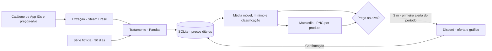

# SmartPrice Tracker & Alert Bot

[](https://www.python.org/downloads/)
[](https://sqlite.org/)
[](.github/workflows/etl.yml)

Monitore jogos na Steam Brasil e descubra se o preço atual está baixo em relação ao histórico observado. O pipeline coleta preços em reais, valida os dados com Pandas, guarda uma observação por produto e dia no SQLite e gera gráficos com Matplotlib. Quando o preço atinge o alvo informado, o Discord recebe o link da loja, as estatísticas e o gráfico.

## Arquitetura



## Estrutura

```text
.
├── .env.example
├── .github/
│   └── workflows/
│       └── etl.yml
├── .gitignore
├── config/
│   └── products.json
├── requirements.txt
├── README.md
├── smartprice/
│   ├── __init__.py
│   ├── __main__.py       # CLI e orquestração
│   ├── analysis.py       # Média móvel, classificação e início do período de oferta
│   ├── reporting.py      # Gráfico e webhook Discord
│   ├── schema.sql        # Tabelas e chaves do SQLite
│   ├── sources.py        # Steam, catálogo e série fictícia
│   ├── storage.py        # Persistência e controle de entregas
│   └── transform.py      # Limpeza e validação com Pandas
├── charts/              # PNGs gerados
└── data/                # Bancos SQLite gerados
```

## Executar a demonstração

Use Python 3.12. A partir da raiz do projeto, no Windows (PowerShell):

```powershell
py -3.12 -m venv .venv
.\.venv\Scripts\python.exe -m pip install -r requirements.txt
.\.venv\Scripts\python.exe -m smartprice --demo
```

Em Linux ou macOS:

```bash
python3.12 -m venv .venv
.venv/bin/python -m pip install -r requirements.txt
.venv/bin/python -m smartprice --demo
```

A demo cria 270 observações em `data/demo.sqlite3` na primeira execução e grava três gráficos em `charts/demo/`. Aventura Pixel aparece como **Oferta Real** a **R$ 29,90** e simula um alerta. Fazenda Solar ilustra **Preço Normal** e Corrida Lunar, **Caro**. A demonstração roda offline depois que as dependências estão instaladas e usa somente produtos fictícios, mesmo quando há um webhook configurado.

## Configurar a coleta real

1. Edite [config/products.json](config/products.json). O `app_id` é o número depois de `/app/` no endereço do jogo. O `target_cents` é o preço-alvo em centavos. Por exemplo, `1500` corresponde a **R$ 15,00**.
2. No Discord, abra **Configurações do servidor → Integrações → Webhooks**, crie um webhook de entrada e copie a URL. Use um canal de teste para a primeira execução.
3. Copie `.env.example` para `.env` e preencha `DISCORD_WEBHOOK_URL`. A URL dá acesso à publicação no canal e deve ficar fora do Git. Com a variável vazia, o pipeline coleta e gera os gráficos com o envio desativado.
4. Execute `python -m smartprice` no ambiente virtual. O histórico ficará em `data/prices.sqlite3` e os gráficos em `charts/steam/`. Os argumentos `--products`, `--db` e `--chart-dir` aceitam caminhos alternativos.

O coletor consulta o endpoint público da Steam Store para o Brasil, usa o preço efetivo em BRL e guarda apenas preços de compra publicados. Produtos indisponíveis ou respostas inválidas geram avisos e lacunas na série. Uma falha parcial gera código de saída 1 depois de processar os itens válidos. O endpoint da loja não possui contrato público de estabilidade. [Steam Store](https://store.steampowered.com/) · [Webhook do Discord](https://docs.discord.com/developers/resources/webhook#execute-webhook)

## Regras de análise e alerta

| Indicador | Regra |
| --- | --- |
| Média móvel de 30 dias | Média das observações válidas dos 30 dias corridos anteriores ao dia avaliado. Dias sem coleta ficam fora do cálculo. |
| Menor preço histórico | Menor valor registrado no banco para o produto, incluindo o preço atual. |
| Oferta Real | Preço atual pelo menos 15% abaixo da média, com pelo menos 7 observações anteriores na janela. |
| Caro | Preço atual pelo menos 10% acima da média, com pelo menos 7 observações anteriores na janela. |
| Preço Normal | Demais casos. Com menos de 7 observações, essa classificação é provisória. |

O gatilho do alerta é o preço-alvo, independentemente da classificação. A primeira observação igual ou abaixo do alvo abre um período elegível. O envio confirmado é registrado no SQLite. Uma observação acima do alvo encerra o período e habilita um novo alerta na próxima queda. Dias sem preço mantêm o último estado observado. Uma falha de envio permite uma nova tentativa enquanto o preço coletado continuar elegível. Se a entrega ocorrer e a confirmação ou a gravação se perder, uma reexecução pode repetir a mensagem.

O banco usa `products` para o catálogo observado, `price_history` para o instantâneo diário e `sent_alerts` para as entregas confirmadas. Uma nova coleta no mesmo dia atualiza a observação desse produto. O dia de referência usa o fuso `America/Sao_Paulo`.

## Agendar com GitHub Actions

1. Publique o projeto no GitHub com o workflow na branch padrão.
2. Em **Settings → Secrets and variables → Actions**, adicione o secret `DISCORD_WEBHOOK_URL` para ativar os alertas.
3. Em **Actions → ETL diário → Run workflow**, use a opção de demonstração para conferir os PNGs e o SQLite nos artefatos. Para testar a coleta real, execute na branch padrão com a opção de demonstração desmarcada.
4. Confira o commit de atualização do histórico na branch padrão e os gráficos em **Artifacts** da execução real.

O cron roda diariamente às **09h17 de Brasília** (**12h17 UTC**), sujeito a atrasos do GitHub Actions. O workflow usa `contents: write` e grava `data/prices.sqlite3` na branch padrão para preservar o histórico entre runners. As regras da branch precisam permitir esse push. Em um repositório público, o banco também é público e contém o catálogo observado, os preços-alvo, o histórico e o registro de entregas. O webhook fica no secret do Actions. [Agendamentos do GitHub Actions](https://docs.github.com/en/actions/reference/workflows-and-actions/events-that-trigger-workflows#schedule)
